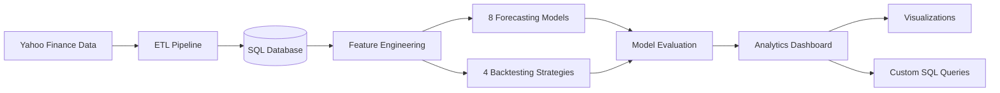
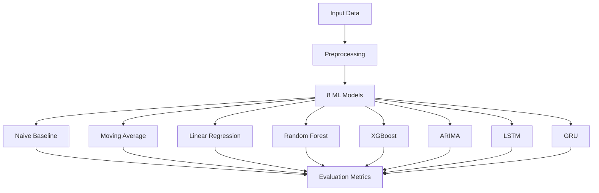
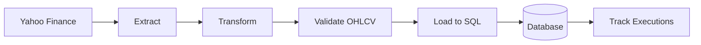
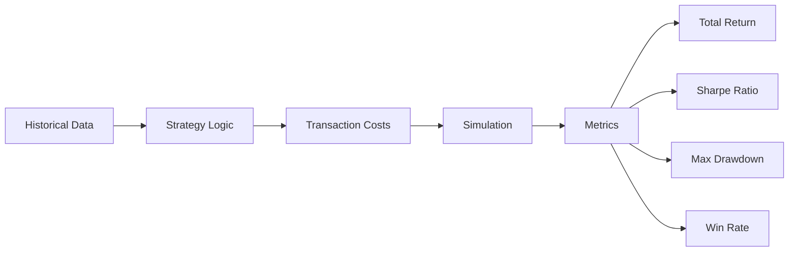

# 📈 Stock Intelligence Platform

<div align="center">


**AI-Powered Stock Intelligence & Forecasting Platform**

[]()
[](https://github.com/samalarakshithbabu/Stock-Intelligence-Platform/issues)

</div>

---

## 🚀 Executive Summary

A comprehensive **AI-powered stock intelligence and forecasting platform** designed for individual investors and analysts. This platform provides robust tools for stock forecasting, backtesting strategies, and technical analysis without look-ahead bias.

### What It Does



---

## 🎯 Problem Statement

| Challenge | Impact |
|-----------|--------|
| **Data Quality** | Inconsistent data from multiple sources |
| **Model Complexity** | Requires expertise to implement multiple ML models |
| **Data Leakage** | Common pitfall that invalidates predictions |
| **Backtesting Bias** | Look-ahead bias produces unrealistic results |
| **Analysis Tools** | Separated tools for forecasting and backtesting |

**Our Solution:** An integrated platform with strict validation methodology, automated data pipeline, and comprehensive ML/AI models.

---

## ✨ Key Features

### 1. Multi-Model Forecasting Engine (8 Models)



| Model | Type | Use Case |
|-------|------|----------|
| **Naive Baseline** | Benchmark | Tomorrow = Today |
| **Moving Average** | Trend | Simple trend following |
| **Linear Regression** | Linear | Linear trend modeling |
| **Random Forest** | Ensemble | Non-linear patterns |
| **XGBoost** | Gradient Boosting | High accuracy predictions |
| **ARIMA** | Statistical | Time-series patterns |
| **LSTM** | Deep Learning | Long-term dependencies |
| **GRU** | Deep Learning | Sequential patterns |

### 2. Strict Time-Series Validation

```
┌─────────────────────────────────────────────────────────────┐
│                    NO DATA LEAKAGE GUARANTEE                 │
├─────────────────────────────────────────────────────────────┤
│ ✓ Chronological splits (no shuffling)                       │
│ ✓ Walk-forward validation                                   │
│ ✓ Scaler fitted only on training data                       │
│ ✓ Technical indicators shifted by 1                         │
│ ✓ No future information in predictions                      │
└─────────────────────────────────────────────────────────────┘
```

### 3. Automated Data Pipeline



### 4. Technical Indicator Engineering

| Indicator | Description | Look-Ahead Protection |
|-----------|-------------|----------------------|
| SMA 20/50 | Simple Moving Averages | Shifted 1 day |
| EMA 20 | Exponential Moving Average | Shifted 1 day |
| RSI | Relative Strength Index | Standard calculation |
| MACD | Convergence/Divergence | Histogram shifted |
| Bollinger Bands | Volatility bands | Standard calculation |
| ATR | Average True Range | Shifted 1 day |
| Volatility | Rolling volatility | Window-based |

### 5. Backtesting Engine



**Strategies Available:**
- **SMA Crossover** - Buy when short SMA crosses above long SMA
- **RSI Strategy** - Buy oversold, sell overbought
- **MACD Strategy** - Trade MACD crossovers
- **Buy & Hold** - Simple benchmark

### 6. SQL Analytics Dashboard

```sql
-- Example: Monthly Performance Summary
SELECT 
    symbol,
    DATE_TRUNC('month', date) as month,
    SUM(volume) as total_volume,
    AVG(close) as avg_price,
    MAX(high) as monthly_high,
    MIN(low) as monthly_low
FROM prices
GROUP BY symbol, DATE_TRUNC('month', date)
ORDER BY month DESC;
```

---

## 🛠️ Technology Stack

### Backend

| Technology | Purpose | Version |
|------------|---------|---------|
| **FastAPI** | Web framework | 0.109+ |
| **Python** | Core language | 3.11+ |
| **SQLAlchemy** | Database ORM | 2.0+ |
| **Pandas** | Data manipulation | Latest |
| **NumPy** | Numerical computing | Latest |
| **Scikit-learn** | ML algorithms | Latest |
| **XGBoost** | Gradient boosting | 1.7+ |
| **Statsmodels** | Statistical models | Latest |
| **TensorFlow/Keras** | Deep learning | 2.15+ |
| **yfinance** | Market data | Latest |

### Frontend

| Technology | Purpose | Version |
|------------|---------|---------|
| **React** | UI library | 18 |
| **TypeScript** | Type safety | 5.0+ |
| **Tailwind CSS** | Styling | 3.4+ |
| **Recharts** | Charts | Latest |
| **React Router** | Navigation | 6+ |
| **Axios** | HTTP client | Latest |
| **Lucide React** | Icons | Latest |

### Database

| Technology | Purpose |
|------------|---------|
| **SQLite** | Development |
| **PostgreSQL** | Production |

---

## 🏗️ System Architecture

```
Stock-Intelligence-Platform/
├── 📱 frontend/                  # React frontend application
│   ├── src/
│   │   ├── components/          # Reusable UI components
│   │   ├── pages/               # Route pages
│   │   ├── services/            # API services
│   │   └── App.tsx              # Main app
│   └── package.json
│
├── ⚙️ backend/                   # FastAPI backend
│   ├── api/                      # REST endpoints
│   │   ├── stocks/              # Stock data endpoints
│   │   ├── models/              # ML model endpoints
│   │   ├── backtesting/         # Backtest endpoints
│   │   ├── analytics/           # Analytics endpoints
│   │   └── pipeline/            # Pipeline endpoints
│   ├── database/                 # Database layer
│   │   ├── models/              # SQLAlchemy models
│   │   └── schemas/             # Pydantic schemas
│   ├── forecasting/              # ML models
│   │   ├── models/              # 8 forecasting models
│   │   └── evaluation/          # Metrics & validation
│   ├── backtesting/              # Strategy simulation
│   ├── indicators/               # Technical indicators
│   ├── pipelines/                # ETL pipelines
│   ├── analytics/                # SQL analytics
│   ├── services/                 # Export services
│   └── main.py                   # Application entry point
│
├── 🐳 docker-compose.yml         # Docker orchestration
├── 📋 requirements.txt           # Python dependencies
└── 📖 README.md                  # This file
```

---

## 📋 API Endpoints

### Stocks

| Endpoint | Method | Description |
|----------|--------|-------------|
| `/api/stocks` | GET | List all stocks |
| `/api/stocks/{symbol}` | GET | Get stock details |
| `/api/stocks/{symbol}/prices` | GET | Historical prices |
| `/api/stocks/{symbol}/prices/latest` | GET | Latest price |

### Forecasting

| Endpoint | Method | Description |
|----------|--------|-------------|
| `/api/models` | GET | List available models |
| `/api/models/evaluate` | POST | Evaluate models |
| `/api/models/forecast` | POST | Generate forecast |

### Backtesting

| Endpoint | Method | Description |
|----------|--------|-------------|
| `/api/backtest` | POST | Run backtest |

### Analytics

| Endpoint | Method | Description |
|----------|--------|-------------|
| `/api/analytics/monthly/{symbol}` | GET | Monthly performance |
| `/api/analytics/yearly/{symbol}` | GET | Yearly performance |
| `/api/analytics/volatility/{symbol}` | GET | Volatility analysis |
| `/api/analytics/query` | POST | Custom SQL query |

### Pipeline

| Endpoint | Method | Description |
|----------|--------|-------------|
| `/api/pipeline/run/{symbol}` | POST | Run pipeline for stock |
| `/api/pipeline/history` | GET | Execution history |
| `/api/pipeline/summary` | GET | Pipeline statistics |

---

## 📊 Model Evaluation Methodology

### Evaluation Metrics

```
RMSE          - Root Mean Squared Error
MAE           - Mean Absolute Error
MAPE          - Mean Absolute Percentage Error
sMAPE         - Symmetric MAPE
R²            - Coefficient of Determination
Directional Accuracy - % correct predictions
```

### The Naive Baseline Rule

```
┌─────────────────────────────────────────────────────────────────┐
│                    NAIVE BASELINE CHECK                         │
├─────────────────────────────────────────────────────────────────┤
│                                                                 │
│   Every model is compared against:                              │
│                                                                 │
│   Tomorrow's Price = Today's Actual Price                       │
│                                                                 │
│   ✓ If sophisticated model can't beat this, it's NOT adding    │
│     value!                                                      │
│                                                                 │
└─────────────────────────────────────────────────────────────────┘
```

---

## 🛠️ Installation

### Prerequisites

- Python 3.11+
- Node.js 18+
- pip / npm
- Git

### 1. Clone Repository

```bash
git clone https://github.com/samalarakshithbabu/Stock-Intelligence-Platform.git
cd Stock-Intelligence-Platform
```

### 2. Backend Setup

```bash
# Create virtual environment
python -m venv venv

# Activate virtual environment
# Windows:
venv\Scripts\activate

# Linux/Mac:
source venv/bin/activate

# Install dependencies
pip install -r requirements.txt
```

### 3. Frontend Setup

```bash
cd frontend
npm install
```

---

## 🚀 Running the Application

### Development Mode

#### Start Backend
```bash
cd backend
python main.py
```
- API: `http://localhost:8000`
- Docs: `http://localhost:8000/docs`

#### Start Frontend
```bash
cd frontend
npm run dev
```
- App: `http://localhost:3000`

### Using Docker

```bash
docker-compose up -d
```

---

## 📖 Usage Guide

### 1. Running a Forecast

```python
import requests

response = requests.post(
    "http://localhost:8000/api/models/forecast",
    json={
        "symbol": "AAPL",
        "model": "lstm",
        "forecast_horizon": 30
    }
)
print(response.json())
```

### 2. Backtesting a Strategy

```python
response = requests.post(
    "http://localhost:8000/api/backtest",
    json={
        "symbol": "AAPL",
        "strategy": "sma_crossover",
        "initial_capital": 10000,
        "short_window": 20,
        "long_window": 50
    }
)
print(response.json())
```

### 3. Custom Analytics Query

```python
response = requests.post(
    "http://localhost:8000/api/analytics/query",
    json={
        "query": "SELECT * FROM prices WHERE symbol = 'AAPL' LIMIT 100"
    }
)
```

---

## 🔮 Future Improvements

- [ ] Real-time data streaming
- [ ] Additional ML models (Prophet, Transformer)
- [ ] Portfolio optimization
- [ ] Sentiment analysis integration
- [ ] Mobile application
- [ ] Cloud deployment templates

---

## ⚠️ Disclaimer

> This platform is for **educational and research purposes only**.
>
> Stock predictions and backtesting results are:
> - Not guaranteed future performance
> - Based on historical data which may not predict future trends
> - Affected by factors not captured in models (market sentiment, news, etc.)
>
> **Never make investment decisions based solely on this platform.**

---

## 📄 License

This project is licensed under the MIT License.

---

## 👨‍💻 Author

**SAMALA RAKSHITH BABU**

- 📧 Email: samalarakshithbabu7@gmail.com
- 💼 LinkedIn: [samala-rakshith-babu](https://www.linkedin.com/in/samala-rakshith-babu/)
- 🐙 GitHub: [samalarakshithbabu](https://github.com/samalarakshithbabu)

---

<div align="center">

**Built with ❤️ for Data-Driven Investment Decisions**

</div>